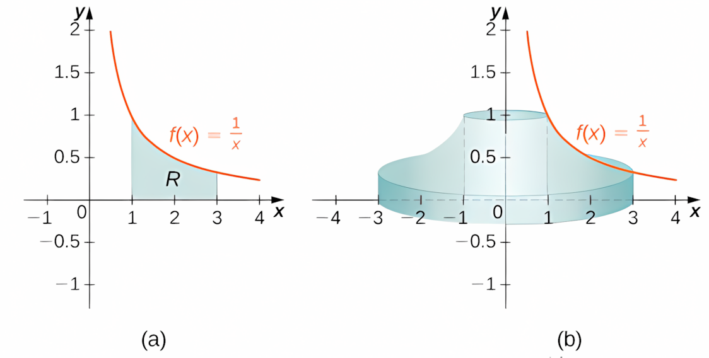
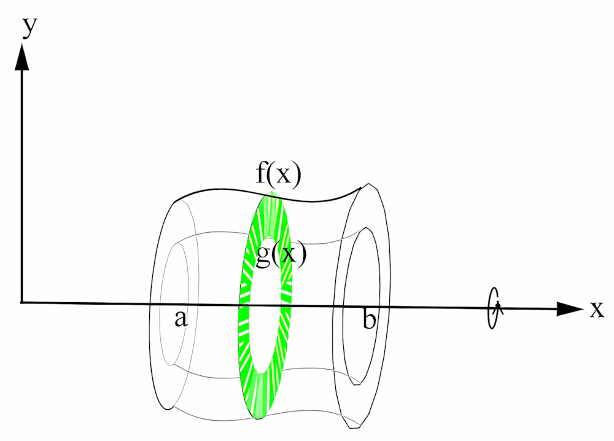
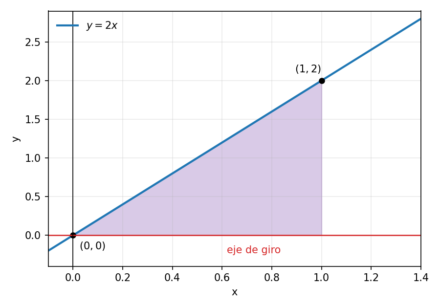
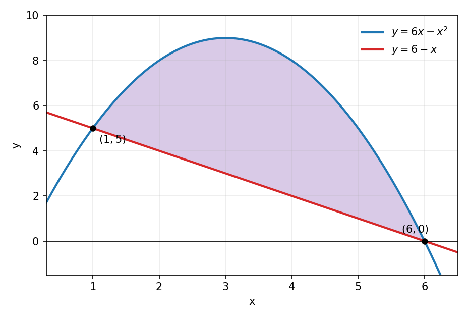
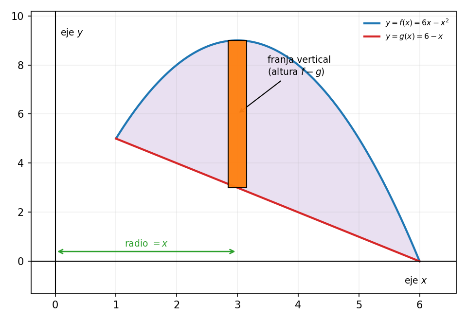
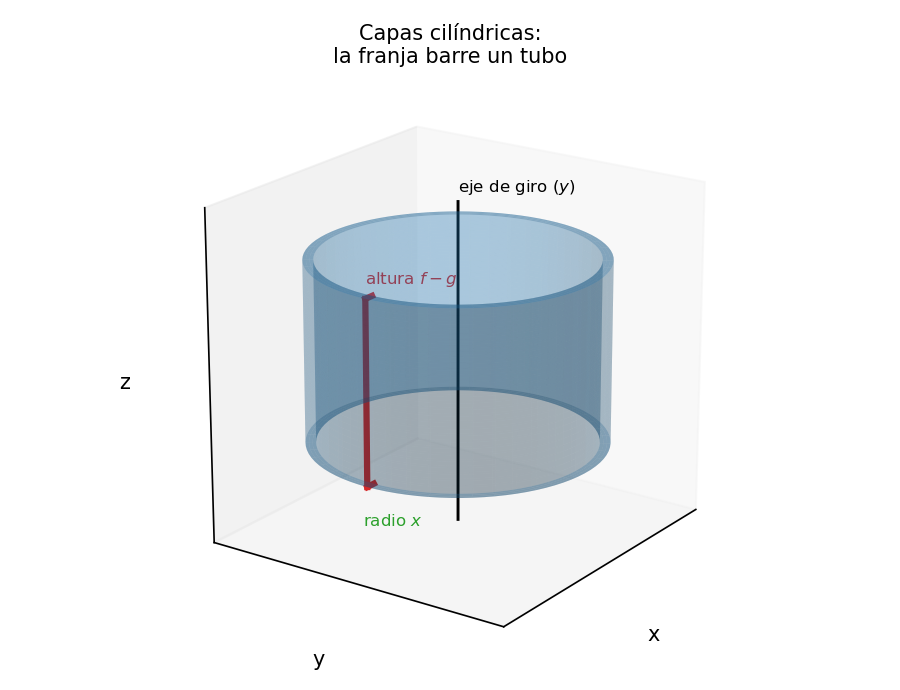
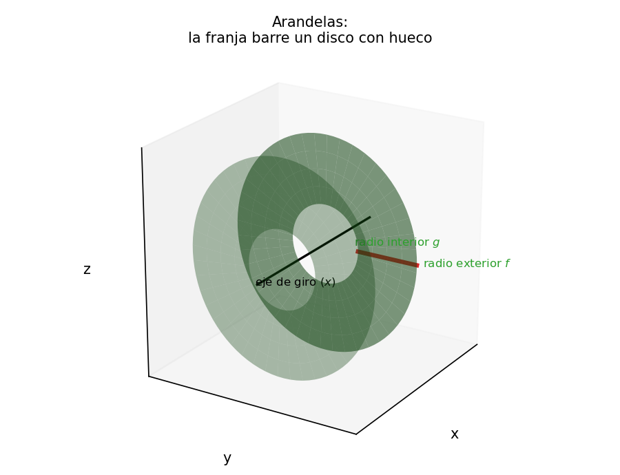
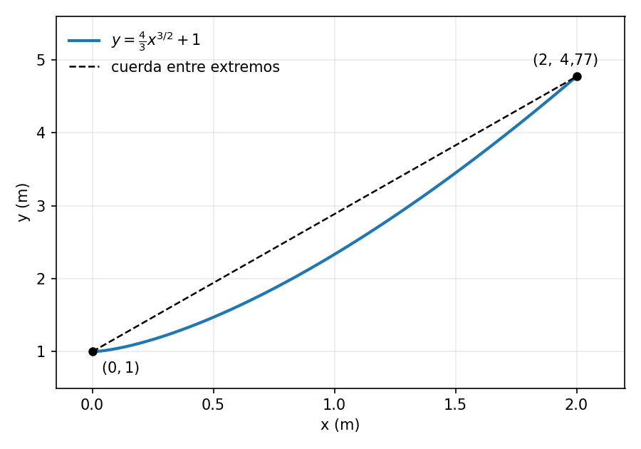
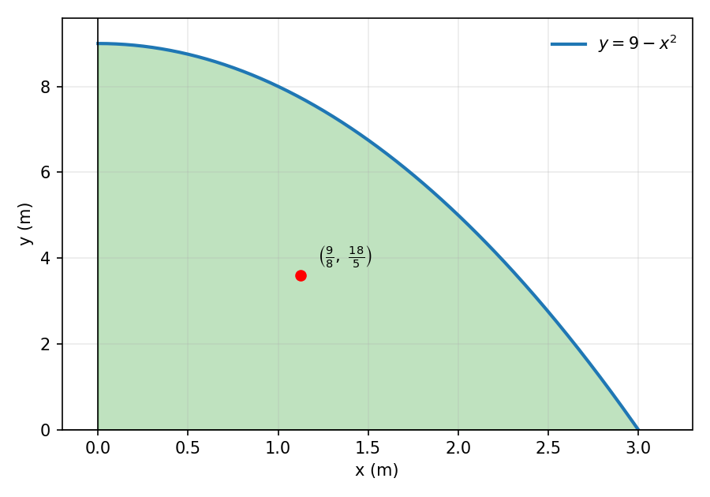
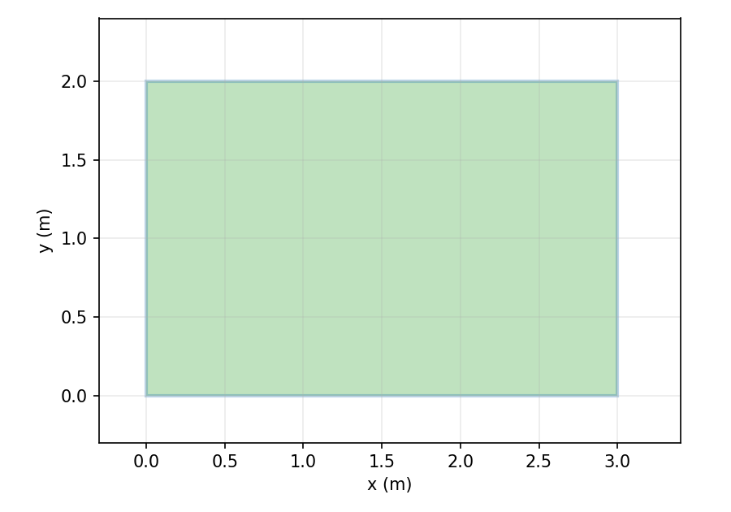

## Objetivos de la clase
Al finalizar la clase, el estudiante será capaz de:

- Calcular volúmenes de revolución por capas cilíndricas y por arandelas.
- Calcular la longitud de arco de una curva.
- Calcular la masa, los momentos y el centro de masas de una placa.
- Justificar el método, los límites de integración y las unidades.

## Volúmenes
Cortamos la región en franjas verticales. Si está limitada por $y=f(x)$ arriba y $y=g(x)$ abajo, en $[a,b]$, con $f\ge g\ge 0$, según el eje de giro:

- Al girar alrededor del eje $y$ usamos capas cilíndricas:
$$V_y=2\pi\int_a^b x\left[f(x)-g(x)\right]dx.$$

::: {style="text-align:center;"}
{width=58%}
:::

##

- Al girar alrededor del eje $x$ usamos arandelas:
$$V_x=\pi\int_a^b\left[f(x)^2-g(x)^2\right]dx.$$

::: {style="text-align:center;"}
{width=58%}
:::

## Longitud de arco
La longitud de arco de $y=f(x)$ entre $a$ y $b$ es
$$L=\int_a^b\sqrt{1+(y')^2}\,dx.$$

## Ejemplo
Región bajo $y=2x$, entre $x=0$ y $x=1$, girada alrededor del eje $x$. En la figura, el radio exterior es $y=2x$ y no hay radio interior.

::: {style="text-align:center;"}
{width=58%}
:::

## 
#### Planteamiento de la integral
Como giramos alrededor del eje $x$, usamos arandelas con radio $f(x)=2x$:
$$V=\pi\int_0^1 (2x)^2\,dx.$$

## 
#### Desarrollo
Elevamos al cuadrado y sacamos la constante:
$$V=\pi\int_0^1 4x^2\,dx=4\pi\int_0^1 x^2\,dx.$$
Integramos con la regla de la potencia y evaluamos:
$$4\pi\left[\frac{x^3}{3}\right]_0^1=4\pi\left(\frac{1}{3}-0\right)=\frac{4\pi}{3}.$$

El volumen es $\frac{4\pi}{3}$ unidades cúbicas. 

## Ejercicio 1
La región está limitada por las curvas
$$y=6x-x^2, \qquad y=6-x.$$
Realice cada uno de los siguientes pasos:

- Obtenga los límites algebraicamente e indique cuál función queda arriba.
- Determine el volumen al girar la región alrededor del eje $y$.
- Determine el volumen al girar la región alrededor del eje $x$.

## La región entre las curvas

::: {style="text-align:center;"}
{width=62%}
:::

## ¿Capas o arandelas?
En el Ejercicio 1 las curvas vienen como $y=f(x)$, así que cortamos en franjas verticales. Con ese corte, el eje de giro decide el método:

- Una franja vertical es **paralela** al eje $y$. Al girar alrededor del eje $y$, la franja barre un tubo de radio $x$: usamos **capas cilíndricas**.
- La misma franja es **perpendicular** al eje $x$. Al girar alrededor del eje $x$, la franja barre un disco: usamos **arandelas**.

#### Regla general
- Elemento de área paralelo al eje de giro: capas cilíndricas.
- Elemento de área perpendicular al eje de giro: arandelas.

#### En el Ejercicio 1
Con franjas verticales, el giro en torno al eje $y$ (parte b) usa capas y el giro en torno al eje $x$ (parte c) usa arandelas.

## La franja vertical

::: {style="text-align:center;"}
{width=60%}
:::

Cortamos la región en franjas verticales. Cada franja está a distancia $x$ del eje $y$ y tiene altura $f(x)-g(x)$.

## Capas cilíndricas

::: {style="text-align:center;"}
{width=48%}
:::

Si giramos la franja alrededor del eje $y$, barre un **tubo** de radio $x$. Al sumar todos los tubos obtenemos las capas cilíndricas.

## Arandelas

::: {style="text-align:center;"}
{width=48%}
:::

Si giramos la misma franja alrededor del eje $x$, barre un **disco con hueco** de radios $f(x)$ y $g(x)$. Al sumar todos los discos obtenemos las arandelas.

## 
#### Límites
Igualamos las curvas:
$$6x-x^2=6-x \implies x^2-7x+6=0 \implies (x-1)(x-6)=0.$$
Los límites son $x=1$ y $x=6$. Evaluando en $x=3$,
$$6(3)-3^2=9, \qquad 6-3=3,$$
así que la parábola $y=6x-x^2$ queda arriba y la recta $y=6-x$ queda abajo.

## 
#### Volumen alrededor del eje y
Usamos capas cilíndricas, con radio $x$ y altura $f(x)-g(x)$:
$$V_y=2\pi\int_1^6 x\left[(6x-x^2)-(6-x)\right]dx=2\pi\int_1^6\left(-x^3+7x^2-6x\right)dx.$$
Integramos:
$$V_y=2\pi\left[-\frac{x^4}{4}+\frac{7x^3}{3}-3x^2\right]_1^6.$$

## 
Evaluamos en los extremos: en $x=6$ la primitiva vale $72$ y en $x=1$ vale $-\dfrac{11}{12}$. Por lo tanto,
$$V_y=2\pi\left(72+\frac{11}{12}\right)=2\pi\cdot\frac{875}{12}=\frac{875\pi}{6}\approx 458{,}15.$$
El volumen es $\dfrac{875\pi}{6}$ unidades cúbicas.

## 
#### Volumen alrededor del eje x
Usamos arandelas, con radio exterior $f(x)=6x-x^2$ y radio interior $g(x)=6-x$:
$$V_x=\pi\int_1^6\left[(6x-x^2)^2-(6-x)^2\right]dx.$$
Desarrollando,
$$(6x-x^2)^2=x^4-12x^3+36x^2, \qquad (6-x)^2=x^2-12x+36,$$
$$(6x-x^2)^2-(6-x)^2=x^4-12x^3+35x^2+12x-36.$$

## 
Integramos:
$$V_x=\pi\left[\frac{x^5}{5}-3x^4+\frac{35x^3}{3}+6x^2-36x\right]_1^6.$$
Evaluando, en $x=6$ la primitiva vale $\dfrac{936}{5}$ y en $x=1$ vale $-\dfrac{317}{15}$, así que
$$V_x=\pi\left(\frac{936}{5}+\frac{317}{15}\right)=\frac{625\pi}{3}\approx 654{,}50.$$
El volumen es $\dfrac{625\pi}{3}$ unidades cúbicas.

## Ejercicio 2
Un cable sigue la curva
$$y=\frac{4}{3}x^{3/2}+1$$
desde $x=0$ hasta $x=2$, con las coordenadas en metros. Determine la longitud del cable, sin considerar holgura.

Realice cada uno de los siguientes pasos:

- Derive la función y simplifique $1+(y')^2$.
- Plantee la integral y resuélvala.

## La curva del cable

::: {style="text-align:center;"}
{width=58%}
:::

## 
#### Derivada
$$y'=\frac{4}{3}\cdot\frac{3}{2}x^{1/2}=2\sqrt{x}.$$
Entonces
$$(y')^2=4x \implies 1+(y')^2=1+4x.$$

## 
#### Integral y sustitución
La longitud es
$$L=\int_0^2\sqrt{1+4x}\,dx.$$
Con $u=1+4x$ tenemos $du=4\,dx$, y los límites cambian así:
$$x=0 \implies u=1, \qquad x=2 \implies u=9.$$
Por lo tanto,
$$L=\frac{1}{4}\int_1^9 u^{1/2}\,du=\frac{1}{4}\cdot\frac{2}{3}\left[u^{3/2}\right]_1^9.$$

## 
Evaluando,
$$L=\frac{1}{6}\left(9^{3/2}-1\right)=\frac{1}{6}(27-1)=\frac{26}{6}=\frac{13}{3}.$$
La longitud del cable es $\dfrac{13}{3}$ metros.

## Masa y centro de masas
Para una placa bajo $y=f(x)$, sobre $y=0$, con densidad constante $\rho$:
$$m=\rho\int_a^b f(x)\,dx, \qquad M_y=\rho\int_a^b x f(x)\,dx, \qquad M_x=\frac{\rho}{2}\int_a^b f(x)^2\,dx.$$
El centro de masas es
$$\bar{x}=\frac{M_y}{m}, \qquad \bar{y}=\frac{M_x}{m}.$$

## Ejercicio 3
Una placa ocupa la región del primer cuadrante bajo $y=9-x^2$, limitada por los ejes. Las coordenadas están en metros y la densidad es $\rho=4$ kg/m².

Realice cada uno de los siguientes pasos:

- Determine el intervalo y la masa de la placa.
- Calcule ambos momentos y las coordenadas del centro de masas.
- Si la densidad pasa a $8$ kg/m², ¿se mueve el centro de masas? Explique sin repetir las integrales.

## La placa

::: {style="text-align:center;"}
{width=56%}
:::

El punto rojo marca el centro de masas calculado más abajo.

## 
#### Intervalo y masa
La curva corta al eje $x$ cuando $9-x^2=0$, es decir, $x=3$ (tomamos la raíz positiva). Por lo tanto $x\in[0,3]$ y
$$m=\rho\int_0^3(9-x^2)\,dx=4\left[9x-\frac{x^3}{3}\right]_0^3=4(27-9)=72.$$
La masa es $72$ kg.

## 
#### Momentos
$$M_y=\rho\int_0^3 x(9-x^2)\,dx=4\left[\frac{9x^2}{2}-\frac{x^4}{4}\right]_0^3=4\left(\frac{81}{2}-\frac{81}{4}\right)=81.$$
$$M_x=\frac{\rho}{2}\int_0^3(9-x^2)^2\,dx=2\int_0^3(81-18x^2+x^4)\,dx.$$

## 
$$M_x=2\left[81x-6x^3+\frac{x^5}{5}\right]_0^3=2\left(243-162+\frac{243}{5}\right)=2\cdot\frac{648}{5}=\frac{1296}{5}.$$

#### Centro de masas
$$\bar{x}=\frac{M_y}{m}=\frac{81}{72}=\frac{9}{8}=1{,}125, \qquad \bar{y}=\frac{M_x}{m}=\frac{1296/5}{72}=\frac{18}{5}=3{,}6.$$
El centro de masas es $\left(\dfrac{9}{8},\dfrac{18}{5}\right)$ metros.

## 
#### Efecto de la densidad
Si la densidad se duplica, tanto la masa como los dos momentos se multiplican por el mismo factor $2$. Por lo tanto los cocientes no cambian:
$$\bar{x}=\frac{2M_y}{2m}=\frac{M_y}{m}, \qquad \bar{y}=\frac{2M_x}{2m}=\frac{M_x}{m}.$$
El centro de masas no se mueve.

## Ejercicio 4
Una placa rectangular ocupa $0\le x\le 3$ y $0\le y\le 2$, con densidad $\rho=5$ kg/m². Obtenga su masa y su centro de masas usando integrales, y verifique el resultado por simetría.

## La placa rectangular

::: {style="text-align:center;"}
{width=56%}
:::

## 
#### Masa y momentos
Como $f(x)=2$ en $[0,3]$,
$$m=\rho\int_0^3 2\,dx=5\cdot 6=30,$$
$$M_y=\rho\int_0^3 x\cdot 2\,dx=5\left[x^2\right]_0^3=45,$$
$$M_x=\frac{\rho}{2}\int_0^3 2^2\,dx=\frac{5}{2}(4\cdot 3)=30.$$

## Centro de masas
$$\bar{x}=\frac{45}{30}=\frac{3}{2}, \qquad \bar{y}=\frac{30}{30}=1.$$
El centro de masas es $\left(\dfrac{3}{2},1\right)$ metros, que coincide con el centro geométrico del rectángulo.

# Gracias por su atención
