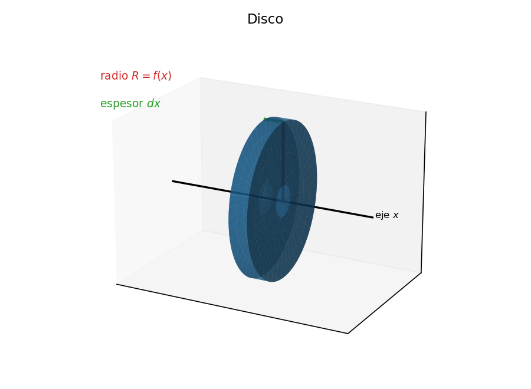
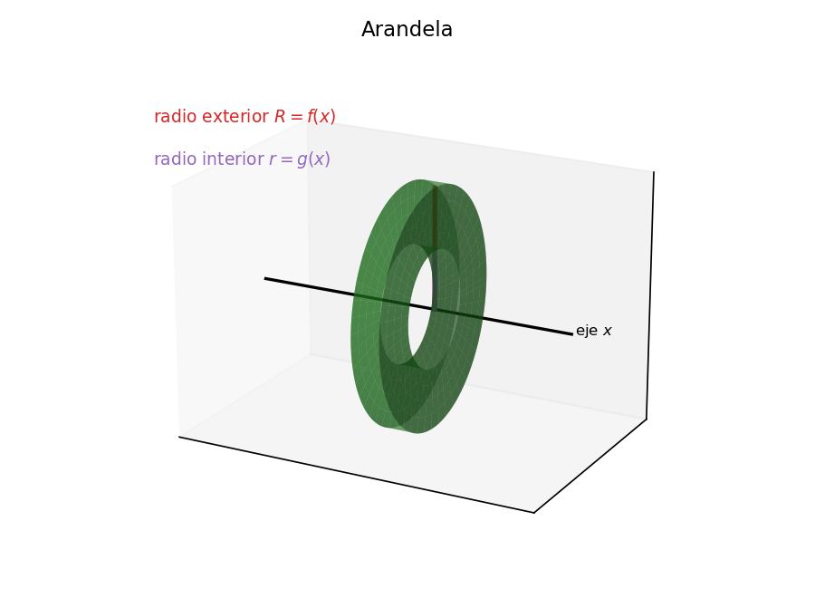
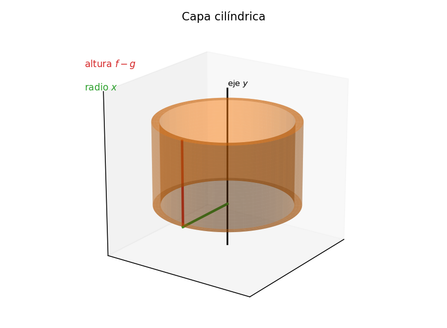

# Sólidos de revolución
Un sólido de revolución se genera al girar una región plana alrededor de una recta llamada eje de giro. Para calcular su volumen, cortamos la región en franjas, identificamos la pieza que genera cada franja y sumamos sus volúmenes con una integral definida.

## La idea central
Todo el cálculo se reduce a tres decisiones:

- Elegir la dirección del corte: franjas perpendiculares o paralelas al eje de giro.
- Identificar la pieza que genera cada franja: un disco, una arandela o un tubo.
- Integrar el volumen de esas piezas entre los extremos de la región.

La dirección del corte conviene elegirla según cómo esté descrita la región, para no tener que despejar variables ni partir la región en tramos.

# Los tres métodos

## Método de discos
Se usa cuando la franja es perpendicular al eje de giro y llega hasta él, de modo que no hay hueco. Al girar, la franja genera un disco de radio $R=f(x)$ y espesor $dx$. Al girar alrededor del eje $x$:
$$V=\pi\int_a^b \left[f(x)\right]^2 dx.$$

::: {style="text-align:center;"}
{width=48%}
:::

## 
#### Ejemplo
Región bajo $y=x$, entre $x=0$ y $x=1$, girada alrededor del eje $x$:
$$V=\pi\int_0^1 x^2 dx=\pi\left[\frac{x^3}{3}\right]_0^1=\frac{\pi}{3}.$$

## Método de arandelas
Se usa cuando la franja es perpendicular al eje de giro, pero hay un hueco: la región no toca el eje. Al girar, la franja genera una arandela de radio exterior $R$ y radio interior $r$. Al girar alrededor del eje $x$, con $f$ arriba y $g$ abajo:
$$V=\pi\int_a^b \left[f(x)^2-g(x)^2\right]dx.$$

::: {style="text-align:center;"}
{width=48%}
:::

## 
#### Ejemplo
Región entre $y=x^2$ y $y=2x$, girada alrededor del eje $x$. Los límites son $x=0$ y $x=2$, y en el intervalo la recta queda arriba:
$$V=\pi\int_0^2\left[(2x)^2-(x^2)^2\right]dx=\pi\int_0^2(4x^2-x^4)dx.$$
$$V=\pi\left[\frac{4x^3}{3}-\frac{x^5}{5}\right]_0^2=\pi\left(\frac{32}{3}-\frac{32}{5}\right)=\frac{64\pi}{15}.$$

## Método de capas cilíndricas
Se usa cuando la franja es paralela al eje de giro. Al girar, la franja genera un tubo de radio $x$, altura $f(x)-g(x)$ y espesor $dx$. Al girar alrededor del eje $y$:
$$V=2\pi\int_a^b x\left[f(x)-g(x)\right]dx.$$

::: {style="text-align:center;"}
{width=48%}
:::

## 
#### Ejemplo
La misma región entre $y=x^2$ y $y=2x$, ahora girada alrededor del eje $y$:
$$V=2\pi\int_0^2 x(2x-x^2)dx=2\pi\int_0^2(2x^2-x^3)dx.$$
$$V=2\pi\left[\frac{2x^3}{3}-\frac{x^4}{4}\right]_0^2=2\pi\left(\frac{16}{3}-4\right)=\frac{8\pi}{3}.$$

# Cómo elegir el método
## Primero la dirección del corte
La dirección del corte depende de cómo esté descrita la región:

- Si la región viene como $y=f(x)$ arriba e $y=g(x)$ abajo, conviene cortar en franjas verticales e integrar en $x$.
- Si viene como $x=R(y)$ a la derecha e $x=L(y)$ a la izquierda, conviene cortar en franjas horizontales e integrar en $y$.

Cortar en la variable en que ya está descrita la región evita despejar y evita partir la región en tramos.

## Después el método según el eje
Con la dirección del corte ya elegida, el método queda determinado por la posición de la franja respecto del eje:

- Franja perpendicular al eje de giro: discos si no hay hueco y arandelas si hay hueco.
- Franja paralela al eje de giro: capas cilíndricas.

## Las cuatro combinaciones
- Corte vertical (integro en $x$) y giro en torno al eje $x$: arandelas, o discos si $g=0$:
$$V=\pi\int_a^b\left[f(x)^2-g(x)^2\right]dx.$$
- Corte vertical (integro en $x$) y giro en torno al eje $y$: capas:
$$V=2\pi\int_a^b x\left[f(x)-g(x)\right]dx.$$

##
- Corte horizontal (integro en $y$) y giro en torno al eje $y$: arandelas, o discos si $L=0$:
$$V=\pi\int_c^d\left[R(y)^2-L(y)^2\right]dy.$$
- Corte horizontal (integro en $y$) y giro en torno al eje $x$: capas:
$$V=2\pi\int_c^d y\left[R(y)-L(y)\right]dy.$$

## Tres preguntas para decidir
- ¿La franja es perpendicular o paralela al eje de giro? Esto decide entre discos/arandelas y capas.
- ¿La región ya está descrita con $y$ en función de $x$ o con $x$ en función de $y$? Esto decide la dirección del corte.
- ¿Algún método obliga a despejar o a dividir la región? Si es así, conviene el otro método.

Cuando ambos métodos son posibles para el mismo eje, los dos deben entregar el mismo volumen. Esa igualdad sirve como comprobación.

# Ejercicios

## Ejercicio 1
La región bajo $y=x^2$, entre $x=0$ y $x=2$, gira alrededor del eje $x$. Calcule el volumen.

## 
#### Solución
La franja es perpendicular al eje $x$ y llega hasta él, así que usamos discos con radio $R=x^2$:
$$V=\pi\int_0^2(x^2)^2 dx=\pi\int_0^2 x^4 dx=\pi\left[\frac{x^5}{5}\right]_0^2=\frac{32\pi}{5}.$$

## Ejercicio 2
La región encerrada entre $y=x$ y $y=x^2$ gira alrededor del eje $x$. Calcule el volumen.

## 
#### Solución
Las curvas se cortan en $x=0$ y $x=1$. En $(0,1)$ la recta $y=x$ queda arriba, así que usamos arandelas con radio exterior $x$ y radio interior $x^2$:
$$V=\pi\int_0^1\left[x^2-(x^2)^2\right]dx=\pi\int_0^1(x^2-x^4)dx.$$
$$V=\pi\left[\frac{x^3}{3}-\frac{x^5}{5}\right]_0^1=\pi\left(\frac{1}{3}-\frac{1}{5}\right)=\frac{2\pi}{15}.$$

## Ejercicio 3
La misma región entre $y=x$ y $y=x^2$ gira ahora alrededor del eje $y$. Calcule el volumen.

## 
#### Solución
La región está descrita con $y$ en función de $x$, así que cortamos en franjas verticales. Como el giro es en torno al eje $y$, la franja es paralela al eje y usamos capas:
$$V=2\pi\int_0^1 x\left(x-x^2\right)dx=2\pi\int_0^1(x^2-x^3)dx.$$
$$V=2\pi\left[\frac{x^3}{3}-\frac{x^4}{4}\right]_0^1=2\pi\left(\frac{1}{3}-\frac{1}{4}\right)=2\pi\cdot\frac{1}{12}=\frac{\pi}{6}.$$

## Ejercicio 4
Para cada caso, indique qué método conviene usar. No calcule el volumen.

- Región dada por $y=f(x)$ arriba e $y=g(x)$ abajo, girada en torno al eje $y$.
- Región dada por $y=f(x)$ arriba e $y=g(x)$ abajo, girada en torno al eje $x$.
- Región dada por $x=R(y)$ a la derecha e $x=L(y)$ a la izquierda, girada en torno al eje $x$.
- Región dada por $x=R(y)$ a la derecha e $x=L(y)$ a la izquierda, girada en torno al eje $y$.

## 
#### Respuestas
- Corte vertical, giro en torno al eje $y$: capas cilíndricas.
- Corte vertical, giro en torno al eje $x$: arandelas, o discos si $g=0$.
- Corte horizontal, giro en torno al eje $x$: capas cilíndricas.
- Corte horizontal, giro en torno al eje $y$: arandelas, o discos si $L=0$.

## Ejercicio 5
Verifique el volumen del Ejercicio 3 usando el otro método.

## 
#### Solución
Para usar arandelas alrededor del eje $y$, cortamos en franjas horizontales. De $y=x$ se obtiene $x=y$, y de $y=x^2$ se obtiene $x=\sqrt{y}$. Para $y\in[0,1]$ el borde exterior es $\sqrt{y}$ y el interior es $y$:
$$V=\pi\int_0^1\left[(\sqrt{y})^2-y^2\right]dy=\pi\int_0^1(y-y^2)dy.$$
$$V=\pi\left[\frac{y^2}{2}-\frac{y^3}{3}\right]_0^1=\pi\left(\frac{1}{2}-\frac{1}{3}\right)=\frac{\pi}{6}.$$
El resultado coincide con el del Ejercicio 3, como debía ocurrir.

# Gracias por su atención
