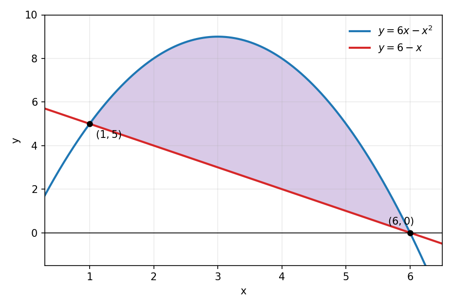
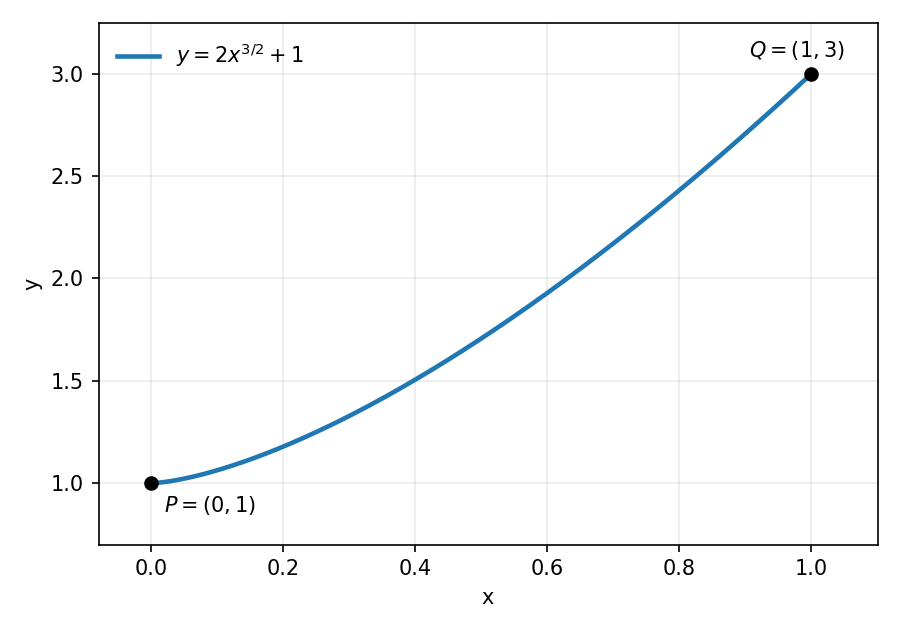
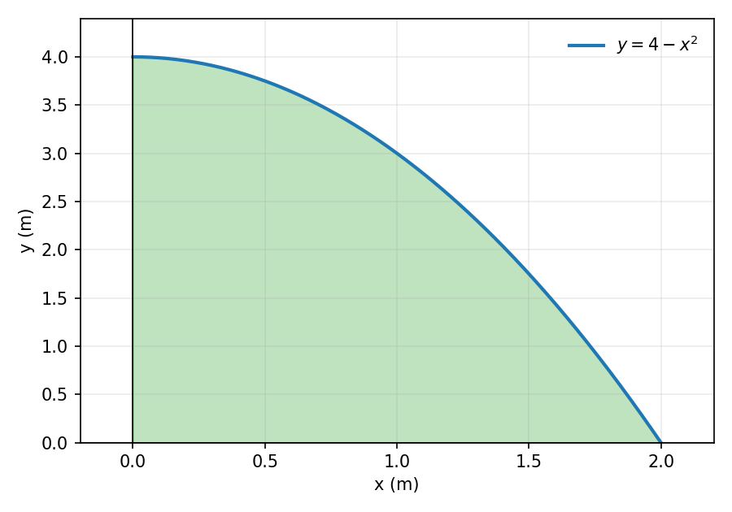

## Presentación
En esta clase resolvemos paso a paso la pauta de la Prueba 2:

- Volúmenes de revolución por capas cilíndricas y arandelas.
- Longitud de arco.
- Masa y centro de masas de una placa.

# Problema 1
## Problema 1
Considere la región $R$ comprendida entre la parábola $y=6x-x^2$ y la recta $x+y=6$.

- Determine el volumen del sólido que se obtiene al girar $R$ respecto del eje $y$.
- Determine el volumen del sólido que se obtiene al girar $R$ respecto del eje $x$.

## Puntos de intersección
Escribimos la recta como $y=6-x$ e igualamos:
$$6x-x^2=6-x \implies x^2-7x+6=0 \implies (x-1)(x-6)=0.$$
Los cortes son $x=1$ y $x=6$. Evaluando en las curvas, los puntos de intersección son $(1,5)$ y $(6,0)$.

En el intervalo $(1,6)$ la parábola queda arriba. Por ejemplo, en $x=3$,
$$6(3)-3^2=9, \qquad 6-3=3.$$

## La región R

::: {style="text-align:center;"}
{width=58%}
:::

## Giro en torno al eje y: planteamiento
La región está descrita con $y$ en función de $x$, así que cortamos en franjas verticales. Como el giro es en torno al eje $y$, la franja es paralela al eje y usamos capas cilíndricas:
$$V_y=2\pi\int_1^6 x\left[(6x-x^2)-(6-x)\right]dx.$$

## Giro en torno al eje y: cálculo
Simplificamos el integrando:
$$V_y=2\pi\int_1^6 x\left(-x^2+7x-6\right)dx=2\pi\int_1^6\left(-x^3+7x^2-6x\right)dx.$$
Integramos:
$$V_y=2\pi\left[-\frac{x^4}{4}+\frac{7x^3}{3}-3x^2\right]_1^6.$$

## 
Evaluamos: en $x=6$ la primitiva vale $72$ y en $x=1$ vale $-\dfrac{11}{12}$. Por lo tanto,
$$V_y=2\pi\left(72+\frac{11}{12}\right)=2\pi\cdot\frac{875}{12}=\frac{875\pi}{6}.$$
El volumen es $\dfrac{875\pi}{6}$ unidades cúbicas.

## Giro en torno al eje x: planteamiento
Ahora la franja vertical es perpendicular al eje $x$, así que usamos arandelas con radio exterior $R(x)=6x-x^2$ y radio interior $r(x)=6-x$:
$$V_x=\pi\int_1^6\left[(6x-x^2)^2-(6-x)^2\right]dx.$$

## Giro en torno al eje x: desarrollo
Desarrollamos cada cuadrado:
$$(6x-x^2)^2=x^4-12x^3+36x^2, \qquad (6-x)^2=x^2-12x+36.$$
Restando,
$$(6x-x^2)^2-(6-x)^2=x^4-12x^3+35x^2+12x-36.$$
Por lo tanto,
$$V_x=\pi\int_1^6\left(x^4-12x^3+35x^2+12x-36\right)dx.$$

## Giro en torno al eje x: cálculo
Integramos:
$$V_x=\pi\left[\frac{x^5}{5}-3x^4+\frac{35x^3}{3}+6x^2-36x\right]_1^6.$$
Evaluando, en $x=6$ la primitiva vale $\dfrac{936}{5}$ y en $x=1$ vale $-\dfrac{317}{15}$:
$$V_x=\pi\left(\frac{936}{5}+\frac{317}{15}\right)=\pi\cdot\frac{3125}{15}=\frac{625\pi}{3}.$$
El volumen es $\dfrac{625\pi}{3}$ unidades cúbicas.

# Problema 2
## Problema 2
Determine la longitud de la curva
$$y=2x^{3/2}+1$$
desde el punto $P=(0,1)$ hasta el punto $Q=(1,3)$.

## La curva

::: {style="text-align:center;"}
{width=56%}
:::

## Derivada y planteo
La fórmula de la longitud de arco es
$$L=\int_a^b\sqrt{1+\left(\frac{dy}{dx}\right)^2}dx.$$
Derivamos:
$$\frac{dy}{dx}=2\cdot\frac{3}{2}x^{1/2}=3\sqrt{x}.$$

##

Entonces
$$\left(\frac{dy}{dx}\right)^2=9x \implies 1+\left(\frac{dy}{dx}\right)^2=1+9x.$$
Los puntos $P$ y $Q$ corresponden a $x=0$ y $x=1$, así que
$$L=\int_0^1\sqrt{1+9x}\,dx.$$

## Sustitución
Con $u=1+9x$ tenemos $du=9\,dx$, y los límites cambian así:
$$x=0 \implies u=1, \qquad x=1 \implies u=10.$$
Por lo tanto,
$$L=\frac{1}{9}\int_1^{10}u^{1/2}\,du.$$

## Cálculo
Integramos:
$$L=\frac{1}{9}\cdot\frac{2}{3}\left[u^{3/2}\right]_1^{10}=\frac{2}{27}\left(10^{3/2}-1\right).$$
Como $10^{3/2}=10\sqrt{10}$,
$$L=\frac{2}{27}\left(10\sqrt{10}-1\right)\approx 2{,}27.$$
La longitud de la curva es $\dfrac{2}{27}\left(10\sqrt{10}-1\right)$ unidades.

# Problema 3
## Problema 3
Una placa delgada ocupa la región del primer cuadrante limitada por la parábola $y=4-x^2$ y los ejes coordenados. La densidad superficial es constante e igual a $\rho=9$ kg/m².

- Determine la masa de la placa.
- Determine el punto $(\bar{x},\bar{y})$ donde debe ubicarse un soporte puntual para que la placa permanezca en equilibrio.

## La placa

::: {style="text-align:center;"}
{width=54%}
:::

## Intervalo y masa
La curva corta al eje $x$ cuando $4-x^2=0$, es decir, $x=2$ (tomamos la raíz positiva). Por lo tanto $x\in[0,2]$ y
$$m=\rho\int_0^2(4-x^2)\,dx=9\left[4x-\frac{x^3}{3}\right]_0^2=9\left(8-\frac{8}{3}\right)=9\cdot\frac{16}{3}=48.$$
La masa es $48$ kg.

## Momento respecto del eje y
$$M_y=\rho\int_0^2 x(4-x^2)\,dx=9\left[2x^2-\frac{x^4}{4}\right]_0^2=9(8-4)=36.$$
Por lo tanto,
$$\bar{x}=\frac{M_y}{m}=\frac{36}{48}=\frac{3}{4}.$$

## Momento respecto del eje x
$$M_x=\frac{\rho}{2}\int_0^2(4-x^2)^2\,dx=\frac{9}{2}\int_0^2\left(16-8x^2+x^4\right)dx.$$
Integramos:
$$M_x=\frac{9}{2}\left[16x-\frac{8x^3}{3}+\frac{x^5}{5}\right]_0^2=\frac{9}{2}\left(32-\frac{64}{3}+\frac{32}{5}\right)=\frac{384}{5}.$$

## Centro de masas
$$\bar{y}=\frac{M_x}{m}=\frac{384/5}{48}=\frac{8}{5}.$$
El soporte debe ubicarse en el centro de masa:
$$(\bar{x},\bar{y})=\left(\frac{3}{4},\frac{8}{5}\right).$$
Es decir, aproximadamente en $(0{,}75,\,1{,}6)$ metros.

## La placa y su centro de masa

::: {style="text-align:center;"}
{width=54%}
:::

# Gracias por su atención
